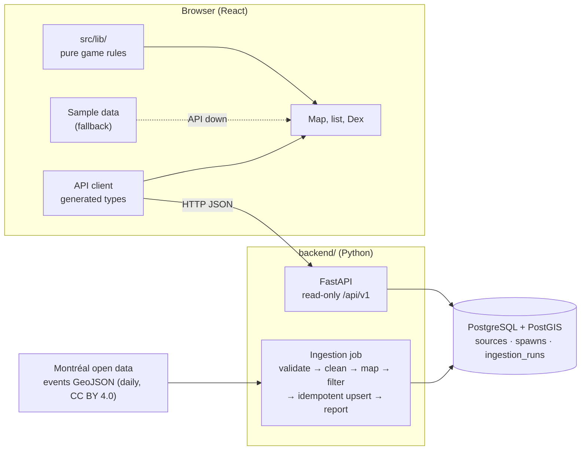

# Spawn

**A live map of real-world experiences happening around you in Montréal, collected like a Pokédex.**

Instead of a list of "top 10 things to do," Spawn shows what is happening near you this week: a free concert, a market, a circus show, an exhibition about to close. Each experience has a **type** (Music, Food, Night, Culture, Sport, Nature, Social) and a **rarity**. You catch an experience by actually being there, and it goes into your personal Dex.

The events are real: a Python backend ingests the **City of Montréal's open data calendar** every day into PostgreSQL/PostGIS and serves it through a REST API. When the backend isn't running, the app falls back to built-in sample data, so it always works as a demo.

> **Status:** working prototype, private, not deployed. Phase 2a (backend and real data) is built; photo verification of catches with CLIP is next. See [Roadmap](#roadmap).

## Features

**App**
- **Map** of Montréal with pins colored by type and styled by rarity (legendary pins glow, spawns ending soon pulse, upcoming ones are dimmed)
- **Location-gated catching**: you must be within 150 m of a spawn while it is live
- **Hidden spawns**: name and place stay secret until you are within 400 m
- **Dex**: progress per type and rarity, XP and levels, history of everything caught
- **Nearby list** sorted with live spawns first, then by distance, with type filters
- **Real GPS or demo mode**: uses your location in Montréal; elsewhere, tap the map to move
- **Real or sample data**: a chip shows which one is in use, and why
- **Share card**: a 1080×1350 image of your Dex, shared through the phone's share sheet
- **Shareable links**: a spawn, tab or filter can be sent as a URL

**Backend**
- **Daily ingestion** of the city's public events: validation, cleaning, category mapping, filtering, idempotent upserts, and a report for every run
- **Geospatial API**: "what's within 5 km of me this week," answered by PostGIS with a spatial index and keyset pagination

## Tech stack

| Layer | Technology |
|---|---|
| Frontend | React 19, TypeScript 6 (strict), Vite 8, Leaflet + react-leaflet |
| API contract | OpenAPI schema generated by FastAPI → TypeScript types generated with openapi-typescript |
| Backend | Python 3.12, FastAPI, Pydantic v2, SQLAlchemy 2, Alembic, httpx |
| Database | PostgreSQL 16 + PostGIS 3.5 (geography points, GiST index) |
| Tooling | uv (Python), npm, Ruff, mypy (strict), oxlint, Docker (Compose, multi-stage API image) |
| Testing | pytest (unit + integration on PostGIS), Vitest + Testing Library |
| CI | GitHub Actions with a PostGIS service container |

## Architecture



Key design decisions, each with its own [decision record](docs/decisions/README.md):

- **Game rules are pure functions** in `src/lib/` (frontend) and `domain/` (backend), so they are tested without a browser or a database. ([ADR 0001](docs/decisions/0001-pure-game-rules.md))
- **Batch ingestion with idempotent upserts** on the natural key `(source, external_id)`, with a content hash so unchanged rows aren't rewritten. Rows that disappear are deactivated, never deleted. ([ADR 0004](docs/decisions/0004-batch-ingestion-open-data.md))
- **PostGIS geography** so distances are in metres on the Earth's surface, with a GiST index for "within X metres" queries. ([ADR 0003](docs/decisions/0003-postgresql-postgis.md))
- **The OpenAPI schema is the contract** between Python and TypeScript; CI fails if it or the generated types are stale. ([ADR 0007](docs/decisions/0007-openapi-contract-generated-types.md))
- **Kafka is a separate learning lab**, not part of the production path, because one file per day doesn't need a message broker. ([ADR 0005](docs/decisions/0005-kafka-as-separate-lab.md))

Full design: [docs/architecture/phase-2a-backend.md](docs/architecture/phase-2a-backend.md).

```
spawn/
├── src/                     React frontend
│   ├── api/                 API client + generated types (schema.d.ts)
│   ├── lib/                 pure game rules (+ tests)
│   ├── hooks/               clock, location, collection, spawns (+ tests)
│   └── components/          map, cards, sheet, catch animation, Dex
├── backend/
│   ├── src/spawn_api/
│   │   ├── domain/          types, rarities, normalized spawn, time windows
│   │   ├── ingest/          sources, cleaning, pipeline, repository, CLI
│   │   ├── db/              models, engine, session, read queries
│   │   └── api/             routers, response models, errors, pagination
│   ├── migrations/          Alembic
│   ├── tests/               unit/ (no database) and integration/ (PostGIS)
│   └── openapi.json         the committed API contract
├── docs/                    architecture, ADRs, roadmap, guides, interview notes
└── docker-compose.yml       PostGIS for local development
```

## Running locally

**Frontend only (sample data):** Node.js 22 (see `.nvmrc`) and npm.

```bash
npm ci
npm run dev        # http://localhost:5173
```

**With real events:** also [uv](https://docs.astral.sh/uv/) and Docker. See [backend/README.md](backend/README.md) for details.

```bash
docker compose up -d                                   # PostGIS
cd backend
cp .env.example .env
uv sync
uv run alembic upgrade head                            # create the schema
uv run python -m spawn_api.ingest montreal-events      # download and ingest real events
uv run python -m spawn_api.ingest curated              # hand-picked evergreen places
uv run uvicorn spawn_api.main:app --reload             # API on :8000, docs at /docs
```

The Vite dev server proxies `/api` to the backend, so `npm run dev` then shows real events.

| Command | What it does |
|---|---|
| `npm test` / `npm run test:watch` | Frontend unit tests |
| `npm run lint`, `npm run typecheck`, `npm run build` | Frontend checks and production build |
| `npm run api:types` | Regenerate TypeScript types from `backend/openapi.json` |
| `uv run pytest` (in `backend/`) | Backend tests; integration tests run when `SPAWN_DATABASE_URL` is set |

## Testing

- **Frontend (61 tests):** distance and its formatting, time windows, catch rules, hidden spawns, XP, the collection hook, the API client's mapping and pagination, and the fallback to sample data.
- **Backend (79 tests, 99% line coverage in CI):**
  - *Unit:* every parsing rule on 26 real rows from the city's file, cleaning, time zones (including the 25-hour day when daylight saving ends), HTTP with a mock transport, API validation and error format.
  - *Integration on PostGIS:* schema constraints, migration round trip, ingestion end to end (idempotence, updates in place, deactivation, the broken-download guard), and every API endpoint (radius, ordering, filters, pagination with no duplicates).

Tests have caught real bugs, each fixed in its own commit: a distance shown as "1000 m" instead of "1.0 km", a crash on corrupted local storage, migration constraint names prefixed twice, and Alembic trying to drop PostGIS's own tables.

## Real data, measured

On the Oct 16, 2026 snapshot of the city's file: **5,254 rows → 2,868 accepted, 2,372 skipped** (mostly already ended or online) **and 14 rejected** (12 with no coordinates, 2 outside Montréal). The whole file parses in about 0.14 s on a laptop. Profiling also found rows with a missing minus sign on the longitude and missing values stored as the string `"nan"`; how each is handled is in the [design doc](docs/architecture/phase-2a-backend.md).

## CI/CD

Two GitHub Actions workflows run on pull requests and pushes to `main`. Path filters run each one only when its part of the repo changes.

**[Frontend CI](.github/workflows/frontend.yml):** `npm ci` → generated API types are up to date → oxlint → `tsc` → Vitest → Vite build → `dist/` uploaded as an artifact.

**[Backend CI](.github/workflows/backend.yml):** `uv sync --locked` → Ruff lint and format → mypy (strict) → OpenAPI schema is up to date → `alembic upgrade head` on an empty database → `alembic check` (models match migrations) → pytest with coverage, against a **PostGIS service container**.

Both use a read-only token and cancel outdated runs. There is no deployment step: the project is intentionally private and not deployed.

### Development workflow

- `main` always passes CI. Work happens on short-lived branches and goes through a pull request.
- Small commits, each describing one change. Tasks are tracked in Jira (`SPAWN-*` keys in branches, commits and PRs).
- GitHub's free plan doesn't enforce branch protection on private repositories, so "merge only when green" is a rule we follow rather than a setting.

## AI-assisted development

Built with **Claude Code** (architecture, implementation, tests, reviews) and **GitHub Copilot** (tasks the owner implements). Every change is reviewed and understood before it's merged. What each tool did is logged in [docs/ai-assisted-development.md](docs/ai-assisted-development.md).

## Roadmap

- [x] Playable frontend prototype, unit tests, CI
- [x] **Backend** (Python / FastAPI) with PostgreSQL + PostGIS
- [x] **Real event ingestion** from Montréal open data
- [x] **Real events in the app**, with generated API types and demo fallback
- [ ] Rarity rules, readiness check, all-day display (owner's Copilot tasks)
- [ ] Jira and Confluence set up ([guide](docs/guides/atlassian-setup.md))
- [ ] **Photo verification** of catches with CLIP zero-shot classification, with a measured evaluation before any accuracy claim
- [ ] Kafka ingestion pipeline as a separate learning lab
- [ ] Map tiles from a provider that allows production use (OpenStreetMap's servers are for development only)

Details: [docs/roadmap.md](docs/roadmap.md).

## Documentation

| Document | Contents |
|---|---|
| [docs/architecture/](docs/architecture/) | System design for each phase |
| [docs/decisions/](docs/decisions/README.md) | Architecture decision records (why each choice was made) |
| [docs/roadmap.md](docs/roadmap.md) | Epics, stories and progress, with a CSV for Jira import |
| [docs/guides/atlassian-setup.md](docs/guides/atlassian-setup.md) | Setting up Jira, GitHub for Jira and Confluence |
| [docs/ai-assisted-development.md](docs/ai-assisted-development.md) | What Claude Code and Copilot were used for |
| [docs/interview-notes.md](docs/interview-notes.md) | Technical decisions explained, phase by phase |

## Technology status

| Technology | Status |
|---|---|
| React, TypeScript, Vite, Leaflet, Vitest | Implemented |
| Python, FastAPI, Pydantic, SQLAlchemy, Alembic, pytest | Implemented |
| PostgreSQL + PostGIS | Implemented (Docker Compose locally, service container in CI) |
| GitHub Actions | Implemented (CI only, no deployment) |
| Docker | Implemented: Compose for PostGIS locally; the API's image is built and smoke-tested in CI, never pushed |
| Claude Code | Used throughout development |
| GitHub Copilot | Tasks assigned (see the AI development notes); log updated as they're done |
| Jira, Confluence | Roadmap CSV and setup guide ready; setup in progress |
| CLIP (PyTorch, Hugging Face) | Next phase |
| Kafka | Planned as a separate learning lab |
| JFrog Artifactory, Argo CD | Not used: not justified for a private, undeployed project of this size |

## Data and license

Event data: [Ville de Montréal, *Événements publics*](https://donnees.montreal.ca/dataset/evenements-publics), CC BY 4.0. The app credits it on the map whenever real events are shown. Map data © OpenStreetMap contributors.

Code: private project, all rights reserved.
