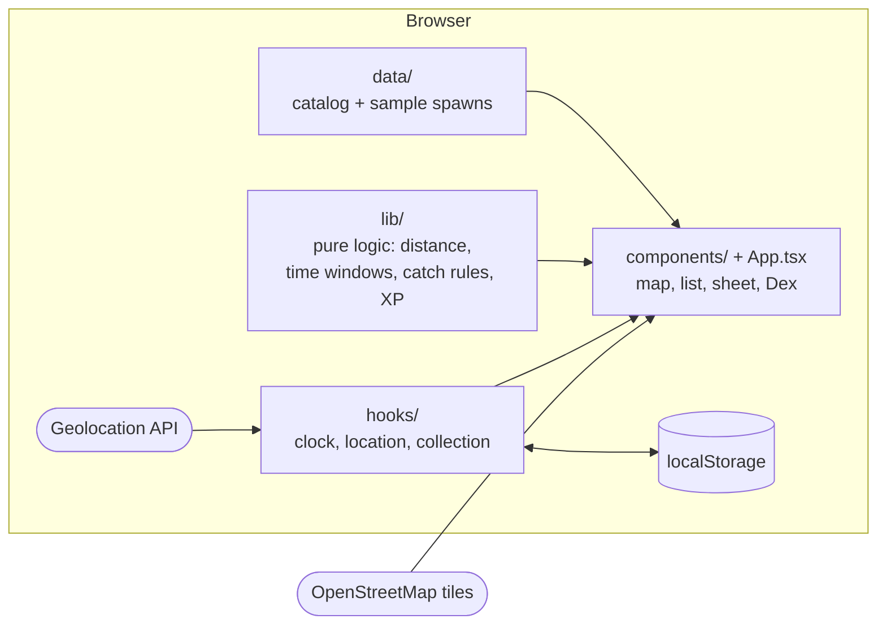

# Spawn

**A live map of real-world experiences happening around you in Montréal, collected like a Pokédex.**

Instead of a list of "top 10 things to do," Spawn shows what is happening *right now* near you, such as a free jazz set, a pickup volleyball game or the last weeks of a seasonal light show. Each experience has a **type** (Music, Food, Night, Culture, Sport, Nature, Social) and a **rarity** that comes from time and place: a daily bagel run is Common, a once-a-year festival is Legendary. You catch an experience by actually being there, and it goes into your personal Dex.

> **Status:** early prototype. The frontend is complete and tested. The event data is a hand-written sample of real Montréal places with simulated times. Real event ingestion and a backend are the next phase (see [Roadmap](#roadmap)).

## Features

- **Live map** of Montréal with pins colored by type and styled by rarity (legendary pins glow, spawns ending soon pulse, upcoming ones are dimmed)
- **Live countdowns** ("ends in 39 min", "starts in 1h 30m") that refresh automatically
- **Location-gated catching**: you must be within 150 m of a spawn while it is live
- **Hidden spawns**: name and place stay secret until you are within 400 m
- **Dex**: progress per type and rarity, XP and levels, history of everything caught
- **Nearby list** sorted with live spawns first, then by distance, with type filters
- **Real GPS or demo mode**: uses your location in Montréal; elsewhere, tap the map to move
- **Offline persistence** of your collection in the browser (`localStorage`)

## Tech stack

| Layer | Technology |
|---|---|
| UI | React 19, TypeScript 6 (strict) |
| Build / dev server | Vite 8 |
| Map | Leaflet + react-leaflet, OpenStreetMap tiles |
| Browser APIs | Geolocation API, `localStorage` |
| Testing | Vitest, Testing Library (React hooks), jsdom |
| Linting | oxlint (warnings fail the build) |
| CI | GitHub Actions |

There is no backend yet; the app is a static single-page application.

## Architecture



The main design decision is that **all rules live in `src/lib/` as pure functions** (no React, no browser APIs). For example, `viewSpawn(spawn, myPosition, now, caught)` returns everything the UI needs to know about one spawn: its status, distance, whether it is concealed and whether it can be caught. Components only render that result. This keeps the rules easy to unit test and easy to move to a backend later.

```
src/
├── data/        catalog.ts (types, rarities, XP), spawns.ts (sample data)
├── lib/         geo.ts, time.ts, spawnView.ts, progression.ts (+ tests)
├── hooks/       useNow, useLocation, useCollection (+ tests)
├── components/  MapView, SpawnCard, SpawnSheet, CatchOverlay, DexView, Badges
└── App.tsx      tabs, filters, selection, catch flow
```

## Running locally

Requirements: Node.js 22 (see `.nvmrc`; Node 20 also works) and npm.

```bash
git clone https://github.com/Alexssuto/spawn.git
cd spawn
npm ci
npm run dev        # http://localhost:5173
```

| Command | What it does |
|---|---|
| `npm run dev` | Start the dev server with hot reload |
| `npm test` | Run the unit tests once |
| `npm run test:watch` | Re-run tests on every change |
| `npm run lint` | Lint with oxlint (fails on warnings) |
| `npm run typecheck` | Type-check the whole project |
| `npm run build` | Type-check and build for production into `dist/` |

Outside Montréal, the app starts in **demo mode**: tap anywhere on the map to move yourself.

## Testing

52 unit tests cover the rules that matter most:

- **Geo**: haversine distance, distance formatting (including the 995 m → "1.0 km" edge case)
- **Time windows**: upcoming / live / ended boundaries, countdown labels, "ending soon"
- **Catch rules**: radius, live-only, no double catches, hidden spawns revealing at 400 m, list ordering
- **Progression**: XP per rarity and level thresholds
- **Collection hook**: saving, restoring, de-duplication, reset, and recovery from corrupted storage
- **Sample data integrity**: unique ids, valid types, all spawns within Montréal

Writing these tests found two real bugs, both fixed in their own commits: distances of 995–999 m displayed as "1000 m", and a non-list value in `localStorage` crashed the app on load.

## CI/CD

[`.github/workflows/ci.yml`](.github/workflows/ci.yml) runs on every push to `main` and every pull request:

1. `npm ci`: clean install from the lockfile
2. **Lint** with oxlint
3. **Typecheck** with `tsc -b`
4. **Unit tests** with Vitest
5. **Build** with Vite, then upload `dist/` as a build artifact (kept 7 days)

The workflow uses a read-only token and cancels outdated runs on the same branch. There is no deployment step: the project is intentionally not deployed publicly.

### Development workflow

- `main` always passes CI. Work happens on short-lived branches (`feat/...`, `fix/...`, `chore/...`).
- Every change goes through a pull request, and is merged only after CI passes.
- Commits are small and each one describes a single change.

Note: GitHub's free plan does not enforce branch protection on private repositories, so "merge only when green" is a team rule here rather than a setting.

## AI-assisted development

This project is built with **Claude Code** and **GitHub Copilot** as tools, with every change reviewed and understood before it is merged. See [docs/ai-assisted-development.md](docs/ai-assisted-development.md) for what each tool was used for.

## Roadmap

- [x] Playable frontend prototype
- [x] Unit tests and CI pipeline
- [ ] **Backend** (Python / FastAPI): API endpoints, database persistence
- [ ] **Real event ingestion** from Montréal open data, normalized into spawns
- [ ] **Photo verification** of catches with CLIP zero-shot classification, with a measured evaluation before any accuracy claim
- [ ] Jira for task tracking and Confluence for architecture decision records
- [ ] Kafka ingestion pipeline as a separate learning project
- [ ] Map tiles from a provider that allows production use (OpenStreetMap's servers are for development only)

Details: [docs/roadmap.md](docs/roadmap.md) (tracked in Jira) and the [Phase 2a backend design](docs/architecture/phase-2a-backend.md).

## Documentation

| Document | Contents |
|---|---|
| [docs/architecture/](docs/architecture/) | System design for each phase |
| [docs/decisions/](docs/decisions/README.md) | Architecture decision records (why each choice was made) |
| [docs/roadmap.md](docs/roadmap.md) | Epics and stories, with a CSV for Jira import |
| [docs/ai-assisted-development.md](docs/ai-assisted-development.md) | What Claude Code and Copilot were used for |
| [docs/interview-notes.md](docs/interview-notes.md) | Technical decisions explained, phase by phase |

## Technology status

| Technology | Status |
|---|---|
| React, TypeScript, Vite, Leaflet | Implemented |
| Vitest, Testing Library | Implemented |
| GitHub Actions | Implemented (CI only, no deployment) |
| Claude Code | Used throughout development |
| GitHub Copilot | Planned, see the AI development notes |
| Python / FastAPI, database | Planned |
| CLIP (PyTorch, Hugging Face) | Planned |
| Jira, Confluence | Planned |
| Kafka | Planned as a separate learning implementation |
| JFrog Artifactory, Argo CD | Not used: not justified for a project of this size |

## License

Private project. All rights reserved.
