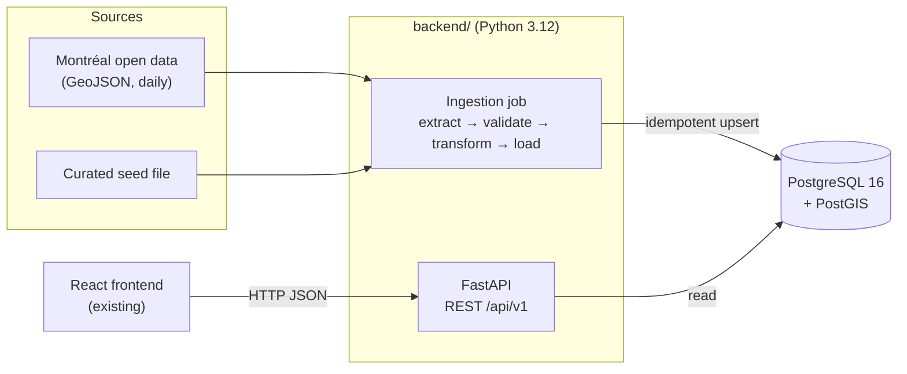
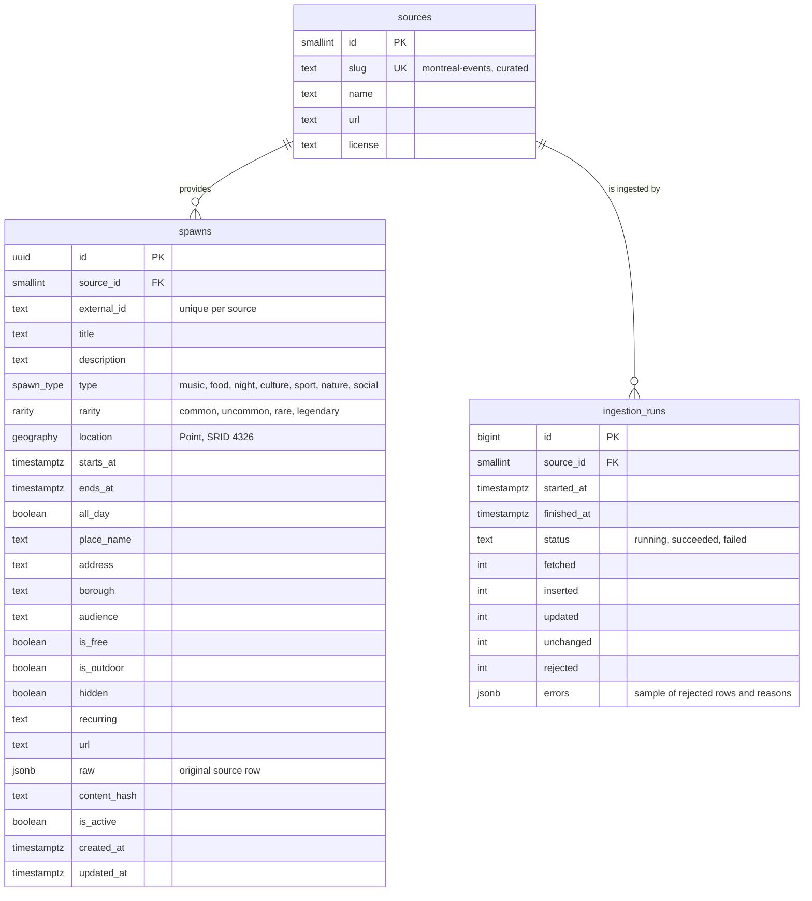

# Phase 2a: backend and real event data (proposal)

**Status:** proposed, waiting for approval before implementation.
**Scope:** a Python backend that ingests real Montréal events, stores them in PostgreSQL and serves them through a REST API that the existing frontend consumes. CLIP photo verification is **out of scope** (Phase 2b).

## 1. Data sources (verified on 2026-10-16)

Both datasets come from the City of Montréal open data portal ([donnees.montreal.ca](https://donnees.montreal.ca)), are licensed **CC BY 4.0** (free use with attribution) and are updated **daily**.

### Primary: "Événements publics" (City calendar)

- GeoJSON, about 4.3 MB, **5,254 events**, of which about **3,300 are current or upcoming** (Oct 2026)
- Fields: `titre`, `description`, `url_fiche`, `date_debut`, `date_fin`, `type_evenement` (28 categories), `public_cible`, `emplacement` (indoor / outdoor / online), `inscription`, `cout` (free / paid), `arrondissement`, address fields, `lat`, `long`

What profiling the real file showed, and how the design handles it:

| Finding | Consequence for the design |
|---|---|
| No ID column, but `url_fiche` is unique across all rows | Use `url_fiche` as the stable `external_id` for upserts |
| **Dates only, no times** (`2026-10-16`) | Spawns get an `all_day` flag; times are stored as start/end of day in `America/Montreal` |
| 95% are single-day; some exhibitions run for months | Duration feeds rarity (one-off events are rarer than long exhibitions) |
| Missing values are the **string** `"nan"` (e.g. address on 5,067 rows) | Cleaning step converts `"nan"`, `"None"` and `""` to real nulls |
| 106 rows have no coordinates | Rejected during validation and counted in the ingestion report |
| 345 events are online, 434 are council meetings | Excluded: they cannot be "caught" in person |
| About 30% target young children (story time, preschool) | Ingested with their audience, but hidden from the default API results |
| Direct downloads without a `User-Agent` header get `RBAC: access denied` | The HTTP client always sends an identifying User-Agent |

### Secondary, later: "Programmation sports et loisirs"

7,733 sports activities **with session times**, but they are mostly registration-based courses, and nested fields are stored as Python-literal strings (`"[{'id': ...}]"`) instead of JSON. Valuable for the Sport type, but more cleaning work. Planned as a second source once the pipeline exists.

### Curated

The 20 hand-written experiences from Phase 1 become a third source (`curated`), loaded from a seed file. They cover what the city calendar doesn't (bagels at St-Viateur, the Kondiaronk lookout).

## 2. Architecture



**Key properties**

- **Ingestion and API are separate processes** that share the database and the domain code. The API never calls the city's servers, so it stays fast and keeps working if the source is down.
- **Ingestion is a batch job** (`python -m spawn_api.ingest`), run on demand now and on a schedule later. One daily file of a few thousand rows does not need streaming (see [ADR 0005](../decisions/0005-kafka-as-separate-lab.md)).
- **Idempotent:** running the job twice produces the same database. Rows are upserted on `(source, external_id)` and only updated when their content hash changes.
- **Observable:** every run is recorded in `ingestion_runs` with counts of fetched / inserted / updated / unchanged / rejected rows, so data problems are visible.
- **Read-only public API:** no write endpoints are exposed in Phase 2a, so there is nothing to authenticate yet. Ingestion is triggered from the command line.

### Ingestion pipeline in detail

```
extract    download GeoJSON with httpx (User-Agent, timeout, retries)
validate   parse each row into a Pydantic model; reject rows with no coordinates or bad dates
clean      "nan" / "None" / "" → null; trim text; normalize whitespace
transform  type_evenement → Spawn type (mapping table); duration + type → rarity;
           audience, price, indoor/outdoor flags; dates → timestamps in America/Montreal
filter     drop online events and council meetings
load       upsert into spawns; mark rows that disappeared from the source as inactive
report     write an ingestion_runs row with counts and errors
```

The `transform` step is **pure functions** (input row → output spawn), the same principle as `src/lib/` in the frontend, so the mapping and rarity rules are unit-tested without a database.

## 3. Database schema



**Indexes**

- `UNIQUE (source_id, external_id)`: the key for idempotent upserts
- `GIST (location)`: fast "within X metres of me" queries with `ST_DWithin`
- `(ends_at)`, partial `WHERE is_active`: most queries only want spawns that haven't ended

**Why keep `raw`:** if the mapping rules change, every spawn can be re-transformed from the stored source row without downloading again. It also helps debug "why does this event have this type?".

Migrations are managed with **Alembic**, so the schema is versioned in Git like the code.

Users and catches stay in the browser (`localStorage`) in Phase 2a. Storing them server-side needs accounts, and is planned together with photo verification, which needs it too.

## 4. REST API (`/api/v1`)

| Method | Path | Purpose |
|---|---|---|
| `GET` | `/health` | Liveness: the process is up |
| `GET` | `/health/ready` | Readiness: the database answers |
| `GET` | `/api/v1/spawns` | Spawns near a point (see parameters below) |
| `GET` | `/api/v1/spawns/{id}` | One spawn |
| `GET` | `/api/v1/catalog` | Types and rarities (labels, colors, XP), so the frontend stops hard-coding them |
| `GET` | `/api/v1/sources` | Data sources, licenses, last successful ingestion |
| `GET` | `/api/v1/ingestion-runs` | Recent runs and their counts (read-only) |

`GET /api/v1/spawns` parameters: `lat`, `lng` (required), `radius_m` (default 5,000, max 25,000), `type` (repeatable), `status` (`live`, `upcoming`, or both), `audience` (child-focused events excluded unless asked), `free`, `limit` (default 100, max 500), `cursor` (pagination).

Example response:

```json
{
  "items": [
    {
      "id": "8f1c…",
      "title": "Spectacle de jazz au parc",
      "type": "music",
      "rarity": "rare",
      "location": { "lat": 45.5085, "lng": -73.5665 },
      "starts_at": "2026-10-18T00:00:00-04:00",
      "ends_at": "2026-10-18T23:59:59-04:00",
      "all_day": true,
      "place_name": "Parc La Fontaine",
      "is_free": true,
      "distance_m": 840,
      "source": "montreal-events",
      "url": "https://montreal.ca/evenements/…"
    }
  ],
  "next_cursor": null
}
```

Design choices worth explaining in an interview:

- **Versioned path (`/api/v1`)** so the contract can change later without breaking clients.
- **Distance is computed in the database** (PostGIS), not by loading every row into Python.
- **Errors use one JSON shape**, and validation errors from FastAPI/Pydantic return `422` with field details.
- **OpenAPI is generated automatically** by FastAPI (`/docs`). The frontend's TypeScript types are generated from it with `openapi-typescript`, so the front and back can't silently disagree.
- **Game rules stay where they are.** The server decides type and rarity (data rules); the browser still decides distance-based things like "can I catch this right now" (`src/lib/`), because they depend on the live GPS position.

## 5. Backend stack

| Concern | Choice | Why |
|---|---|---|
| Language | Python 3.12 | Goal of strengthening Python; strong data tooling |
| Web framework | FastAPI | Type-hint-driven validation, automatic OpenAPI, widely used |
| Validation / settings | Pydantic v2, pydantic-settings | Same models validate source rows, API responses and config |
| Database | PostgreSQL 16 + PostGIS | Relational integrity, real geospatial queries, industry standard |
| ORM / migrations | SQLAlchemy 2.0 + GeoAlchemy2, Alembic | Explicit SQL when needed, versioned schema |
| DB driver | psycopg 3 | Current PostgreSQL driver |
| HTTP client | httpx | Timeouts and retries for the source download |
| Packaging | uv | Fast, lockfile-based, manages the Python version |
| Quality | Ruff (lint + format), mypy, pytest | Same "lint → typecheck → test" gates as the frontend |
| Local environment | Docker Compose | One command starts PostgreSQL/PostGIS |

Synchronous SQLAlchemy is used on purpose: FastAPI runs sync endpoints in a thread pool, and at this scale async adds complexity without a measurable benefit.

## 6. Repository layout

The frontend stays where it is (no churn, nothing breaks). The backend is added beside it:

```
spawn/
├── src/                     existing React frontend
├── backend/
│   ├── pyproject.toml, uv.lock
│   ├── alembic/             migrations
│   ├── src/spawn_api/
│   │   ├── api/             FastAPI routers
│   │   ├── domain/          pure rules: type mapping, rarity, cleaning
│   │   ├── ingest/          sources (extract), pipeline, CLI entry point
│   │   ├── db/              SQLAlchemy models, session, queries
│   │   └── settings.py
│   └── tests/
│       ├── unit/            pure functions, no database
│       ├── integration/     real PostGIS (Docker locally, service container in CI)
│       └── fixtures/        small anonymized samples of the real GeoJSON
├── labs/kafka-ingestion/    separate learning project (ADR 0005)
├── docker-compose.yml       postgis for local development
└── docs/
```

## 7. CI/CD changes

The existing workflow gets a second job, `backend`, that only runs when `backend/` changes:

1. `uv sync --locked`
2. `ruff check` and `ruff format --check`
3. `mypy`
4. `alembic upgrade head` against a **PostGIS service container** (proves migrations apply to an empty database)
5. `pytest` (unit + integration) with coverage report
6. `docker build` of the API image (built to prove it builds, **not pushed or deployed**)

A scheduled workflow can later run ingestion against a test database to detect when the city changes its file format.

## 8. How each technology fits

| Technology | Role in Spawn | Level |
|---|---|---|
| **GitHub Actions** | Frontend + backend CI with a real database service container; Docker build; path filters | Implemented in Phase 2a |
| **Jira** | All Phase 2a work tracked as epics and stories; branch names and commits carry the issue key (`SPAWN-12`) and link automatically with the GitHub for Jira app | You set it up and run it (CSV import provided) |
| **Confluence** | Architecture page + architecture decision records (ADRs), mirrored from `docs/` | You set it up; content provided |
| **Jira Service Management** | Optional: a small "report a wrong event" portal for data-quality issues | Optional learning task, marginal value |
| **Kafka** | Not in the production path. Separate lab: the same ingestion transform behind a producer, topics, a consumer group and a dead-letter topic | Separate learning implementation |
| **GitHub Copilot** | Stories labeled `copilot-practice` are for you to implement with Copilot's help | You use it |
| **Claude Code** | Architecture, scaffolding, reviews (`/code-review` on each PR), tests, documentation | In use |
| **JFrog Artifactory** | The API Docker image would be stored in a registry; GitHub Container Registry plays that role here. Concept only | Explained, not implemented |
| **Argo CD** | Requires Kubernetes and a deployment; the project is intentionally not deployed | Not used |

## 9. Risks and open questions

- **City calendar content skews toward libraries and community events.** It is real data, but fewer "jazz on the terrace" moments than the hand-written sample. The curated source and later sources fill the gap.
- **No times in the data** means real spawns show "today" or "until Nov 3" rather than minute countdowns. The UI gets an all-day display.
- **Type and rarity mapping is a judgment call.** It is a small, tested table that is easy to tune, not hidden logic.
- **Source format changes** would break ingestion. Pydantic validation fails loudly, the run is recorded as failed, and the previous data stays in place.
